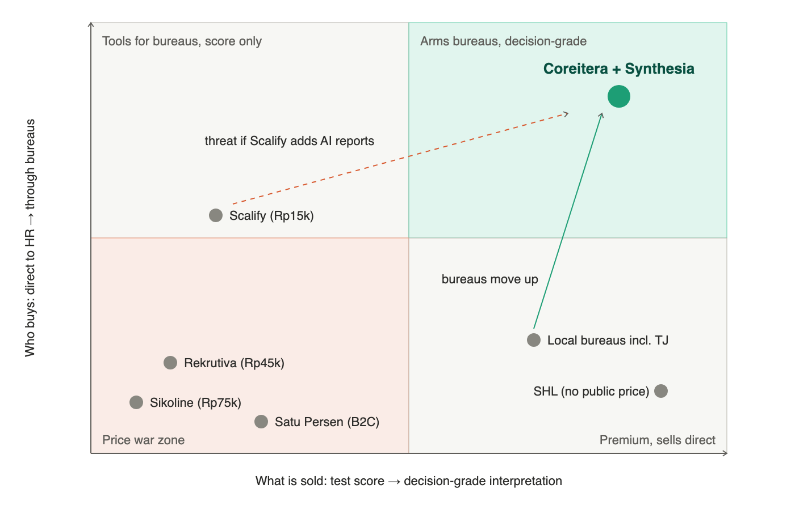

COREITERA · BUSINESS PROPOSAL · STRATEGIC LEVEL · DRAFT v0.2

**Coreitera Synthesia: the AI interpretation and workflow platform for psychology bureaus that serve corporates in Indonesia.** Bureaus win corporate hiring, rotation and promotion work at a premium. Synthesia lets their psychologists sign faster, more consistent reports at a lower cost per report.

| Item | Status |
|---|---|
| Purpose | Record the market-focus decision at strategy level. Financial detail comes later from the Coreitera model |
| Template | IS5116 business proposal structure (Team Quotient final proposal), 11 sections plus appendices |
| Number labels | **[K]** known, **[P]** our plan or price decision, **[E]** estimate to validate |
| Open inputs | Synthesia weekly users today, and the 6-month revenue split by unit (assessment, Synthesia, Teta/EAP) |

Contents: 1 Executive summary · 2 Problem and value proposition · 3 Market · 4 Products and services · 5 Competitive marketing and sales · 6 Sustainable competitive advantage · 7 Team · 8 Operational plan · 9 Expansion plan · 10 Financials · 11 Conclusion · Appendices A-F

# 1 Executive summary

**The decision.** Coreitera will not join the psychotest price war. We will target **psychology bureaus that serve corporates**, starting in Jakarta. We will arm them with Synthesia so they win high-stakes corporate work (hiring shortlists, repositioning, rotation, promotion) at a premium price.

**The market shift.** Online test delivery is becoming a commodity. Published prices already start at Rp15k per participant (Scalify), and most rivals sit between Rp45k and Rp75k (Rekrutiva, Sikoline) [K]. By 2028 we expect a bare test to be close to free or bundled into HR software [E]. The value moves to two places that cannot be commoditised: the **signed interpretation** (only a licensed psychologist may interpret results) and the **bureau's workflow and client history**.

**Our position.** Nobody owns the space "decision-grade interpretation, sold through bureaus". Self-serve platforms sell scores. SHL sells premium assessment directly to large corporates. Local bureaus sell interpretation by hand. Synthesia sits in the empty quadrant (Section 5).

**How we win.**

1. **Test delivery at cost**, white-labelled under the bureau's own brand, so a bureau never loses a deal on test price.
2. **Interpretation as the profit engine**: AI drafts, the psychologist reviews and signs, priced by the stakes of the decision.
3. **Workflow and history as the lock-in**: comparable reports for the same employee across hiring, rotation and promotion.
4. **Through the bureaus, not around them**: Coreitera never sells tests directly to corporates, so every bureau sees us as a supplier, not a rival.

**What we will not do.** No predatory pricing: we cannot survive below cost, recoupment is unlikely when entry is cheap, and selling below cost to remove rivals is banned under Article 20 of UU 5/1999. No FUD about rivals: in a trust category, it would damage the trust that is our moat. We raise the standard with evidence instead.

**Two services, in this order.**

1. **Signed decision** (Synthesia): the moat and the margin. Built first.
2. **Self-test platform** at a price that matches rivals one to one, with a built-in "get it signed" upgrade to a partner bureau. Launched last, once the signed-decision layer has lock-in.

**Sequence.** Build the slow assets before we become visible. Rivals can copy software and price in months. They cannot quickly copy a loyal psychologist network, employee history, or TJ's trust with BI, OJK and banks.

| Phase | When [P] | What |
|---|---|---|
| 0. Protect the engine | Now to 18 Jan 2027 | TJ closes its 2027 deals. Coreitera does quiet preparation only |
| 1. Build the moat inside TJ | Feb to Apr 2027 | Synthesia on every TJ client. First rotation pack |
| 2. Arm outside bureaus | May to Sep 2027 | 10, then 30 bureaus, outside TJ's target accounts |
| 3. Launch self-test | Q4 2027 onward | Matching price, with upgrade routed to member bureaus |

**Who decides to buy.** Our primary constituent now is the **bureau owner who is a senior psychologist**: they buy on quality and set the trend. The psychologist who signs is our key secondary constituent. We expect the decider to shift to ops and finance as bureaus grow (Section 5.1).

**First steps.** Protect TJ's selling window until 18 January 2027. Hire a licensed industrial and organisational psychologist as Bureau Partnerships Lead. Use Teman Journey (TJ) as the proof site, behind a written data firewall.

# 2 Problem statement and value proposition

## 2.1 The big pain

Psychology bureaus that serve corporates are squeezed from two sides.

- **Price pressure from below.** HR managers see online tests at Rp15k to Rp75k per person and push bureaus to cut their prices.
- **Cost pressure inside.** A bureau's real cost is psychologist hours: scoring, interpreting and writing each report by hand. Psychologists are scarce, so a bureau cannot grow without hiring more of them.

The result is a bureau that works harder for less money and cannot take on large corporate projects.

## 2.2 Why current solutions fall short

| Option | What it gives | Why it falls short for a bureau |
|---|---|---|
| Self-serve test platforms (Scalify, Rekrutiva, Sikoline) | Cheap tests and scores | No interpretation. Some sell directly to the bureau's own corporate clients |
| Enterprise assessment (SHL) | Premium, trusted assessment | Sold direct to large corporates. Too costly to resell. Not built for local bureaus |
| Manual work (Word, Excel, WhatsApp) | Full control | Slow, inconsistent between psychologists, no history per employee |
| Consumer platforms (Satu Persen) | Tests plus counselling for individuals | Built for consumers, not for corporate decisions |

## 2.3 Our offering and what is new

Synthesia gives a bureau three things in one plan:

1. **A test engine under the bureau's brand**, priced at market level.
2. **An AI interpretation copilot**: it drafts the report against a shared competency model, and the psychologist reviews, edits and signs.
3. **Bureau workflow and employee history**: clients, projects, scheduling, reports, and one comparable record per employee across hiring, rotation and promotion.

What is new: no player in Indonesia combines psychologist-signed interpretation, a white-label engine and history over time, sold through bureaus.

## 2.4 Value proposition: pain and pain-killer

| Pain | Pain-killer |
|---|---|
| "We lose deals because online tests are cheaper" | White-label engine at market price. Compete on price for the test, win on the report |
| "Our psychologists spend hours per report" | AI draft plus psychologist review. Target: at least 30% less time per report [E] |
| "Reports differ between our psychologists" | One competency model and one scale for every report |
| "Corporates ask for SHL-level work we cannot staff" | Assessment-centre-lite packs for rotation and promotion |
| "Clients leave after one project" | Employee history makes the next assessment more useful with the same bureau |

## 2.5 Quantified benefits (targets to confirm)

| Benefit | Target | Status |
|---|---|---|
| Time saved per interpreted report | At least 30% | [E] Measure in the TJ pilot |
| Reports per psychologist per month | +50% with the same hours | [E] |
| Corporate deals lost on test price | Close to zero | [E] |
| Repeat corporate clients per bureau | Higher, driven by history | [E] Baseline to collect |

# 3 Market identification and analysis

## 3.1 Market size, bottom-up

Strategy-level frame. The numbers come later from the Coreitera model.

- Unit: psychology bureaus in Indonesia that serve corporates.
- Revenue per bureau: subscription (Rp1M / Rp2.9M / Rp5.73M a month by size [P]) plus a fee per signed report [P, to set].
- Plan targets: about 243 bureaus signed by Dec 2027, about 700 paying by Dec 2028 [P, Coreitera model 20 Oct 2026].
- To fill: number of bureaus with industrial practice (from HIMPSI/APIO or our own count), and the average number of corporate reports per bureau per month.

## 3.2 Customers and segments

| Segment | Description | Priority |
|---|---|---|
| **Beachhead**: Jakarta bureaus with industrial practice | 4 to 10 psychologists, serving mid-size and large corporates | 1 |
| Bureaus in Bandung, Surabaya and other large cities | Same profile, outside Jakarta | 2 |
| Small practices (1 to 3 psychologists) | Occasional corporate work | 3 |
| National corporates (banks, BUMN) | Reached **through** member bureaus, never directly | Network stage |

## 3.3 Favourable trends

- Test delivery is becoming a commodity, which pushes bureaus to find value elsewhere.
- Corporates move people more often (rotation, restructuring, promotion), so high-stakes assessment grows.
- Psychologists are scarce, so tools that raise output per psychologist are worth paying for.
- AI is now good enough to draft reports, while law and ethics still require a human signature. Assistive AI fits that gap.
- Data protection (UU PDP) raises the bar for handling psychological data. That favours a compliant platform over manual files.

## 3.4 What each bureau gains, by size

| Bureau size | Plan [P] | Main gain |
|---|---|---|
| 1 to 3 psychologists | Rp1M a month | Takes corporate projects it could not staff before |
| 4 to 10 psychologists | Rp2.9M a month | More reports per psychologist, consistent quality |
| 11 or more | Rp5.73M a month | Runs assessment-centre-lite projects and keeps history across clients |

# 4 Company products and services

## 4.1 Plans and prices

Price by **the decision the report supports**, not by the test.

| Use case | Volume | Stakes | Deliverable | Price per person to the corporate (bureau sets it) |
|---|---|---|---|---|
| Mass screening | High | Low per person | Auto-scored test, short summary | Rp15k to 25k [E], matching the market |
| Hiring shortlist | Medium | Medium | Interpreted, signed report with role fit | Rp150k to 350k [E] |
| Repositioning, rotation, promotion | Low | **High** | Report + interview + fit to new role + development plan | Rp500k to 1.5M or more [E] |

Coreitera earns from:

1. the bureau subscription [P],
2. a small fee per signed report [P, to set], so we grow when bureaus grow,
3. the test engine at about cost (no margin target).

## 4.2 The lead use case: rotation and promotion

We lead with repositioning, rotation and promotion because:

- it carries the highest value,
- only SHL serves it today,
- it builds the employee history that locks clients in.

Hiring shortlists are the volume entry point.

## 4.3 Service 2: the self-test platform (Phase 3)

- **What:** self-serve tests for HR teams and small businesses, at a price that matches rivals one to one (Scalify from Rp15k, Rekrutiva from Rp45k).
- **Why it can win at the same price:** every result has a one-click "get it signed" upgrade. A partner bureau's psychologist interprets and signs. Rivals sell scores only.
- **Channel rule:** the upgrade always routes to a member bureau, and Coreitera earns a routing fee. Coreitera never interprets for corporates directly, so bureaus keep seeing us as a supplier.
- **Why last:** a matching price only neutralises price. Without the signed-decision layer behind it, it is just another cheap test, and it would anchor Coreitera as "the cheap brand".

## 4.4 Compliance-safe by design: how we handle data

- The AI drafts and a licensed psychologist reviews and signs every report. No exceptions.
- Each bureau owns its clients' data. Coreitera processes it on the bureau's behalf.
- A written data firewall separates bureaus from each other and from TJ.
- Design follows UU PDP for sensitive personal data. Details are in the technical plan.

# 5 Competitive marketing and sales strategy

## 5.1 Who decides to buy: primary and secondary constituents

The customer is the person who **decides** to buy, not only the person who uses the product. In B2B, a buying centre has five roles: decider, payer, user, influencer and gatekeeper.

**Lesson from RoboTech (HBS 9-918-501).**
- Early on, top hospitals bought because star surgeons, who were both users and deciders, wanted the best technology.
- At scale, hospital administrators became the deciders. They bought on ROI, delivery, service and price.
- RoboTech kept selling technology and lost the new decider.
- For us: early deciders buy on quality, later deciders buy on economics and reliability.

| Phase | Primary constituent (decider) | They buy on | Secondary constituents |
|---|---|---|---|
| 1. Inside TJ | Corporate HR or L&D head at BI or a bank | Proof of behaviour change, a defensible report | Employees (users), regulator (influencer), procurement (payer) |
| 1b. Rotation and promotion pack | HR business partner or talent head. Directors often give final approval | "Can I defend this decision?" | Managers being moved (users), board (influencer) |
| 2. Synthesia for bureaus | **Bureau owner, usually a senior psychologist** | Report quality, reputation, winning corporate deals | **Psychologists who sign (users)**, admin (gatekeeper), APIO, HIMPSI and peer owners (influencers) |
| 2 at scale (2028, 11+ staff) | Ops manager or finance | Cost per report, uptime, onboarding speed, price | Owner becomes an influencer |
| 3. Self-test platform | HR recruiter or small-business owner | Price, speed, ease | Candidates (users) |
| Network (2028) | National corporate procurement | One standard in every city, compliance, price | Member bureaus become suppliers |

**Setting the trend.** We start with bureau owners who buy on quality. They let us charge a premium, set the report standard and refer their peers. If our first buyers were price-sensitive HR recruiters, they would anchor Coreitera as cheap.

**Rules that follow:**
- Sell to the owner and design for the psychologist who signs. Psychologists who dislike the tool make owners churn.
- Log "who signed" and "who blocked, and why" for every deal. When objections move from quality to price or uptime, the decider has shifted.
- Build uptime, onboarding and cost-per-report features before 2028, ahead of the shift to ops and finance.

## 5.2 Where we compete

{width=95%}

- **Bottom-left is the price-war zone.** Prices only go down there.
- **Bottom-right is premium, sold direct.** SHL serves large corporates. Local bureaus, TJ included, serve the rest by hand.
- **Top-right is empty. That is our quadrant.**
- **The main threat is Scalify.** It already sells to bureaus. If it adds AI reports, it moves into our quadrant.

## 5.3 Comparison matrix

| | Scalify | Rekrutiva | Sikoline | Satu Persen | SHL | **Synthesia** |
|---|---|---|---|---|---|---|
| Main buyer | Companies, schools, bureaus | HR | HR | Consumers | Large corporates | **Bureaus** |
| Published price | From Rp15k per participant | From Rp45k (Rp75k proctored) | Rp75k per session | Rp60k to 79k (promo) | Not published | Subscription + per report |
| Psychologist-signed interpretation | No claim | No | No claim | Consult add-on | Yes, own staff | **Yes, bureau's psychologist** |
| White-label for bureaus | Partial | No | No | No | No | **Yes** |
| History per employee | No | No | No | No | Yes | **Yes** |
| Price-war exposure | High | High | High | Medium | Low | **Low** |

## 5.4 Competitors in depth

- **Scalify:** pay-per-use platform with no minimum. Premium tests with "Indonesian norms" at Rp20k to 40k per tool. Sells to bureaus. Our closest threat. Watch their roadmap every month.
- **Rekrutiva:** AI-first HR suite (test, AI interview, ATS) on a prepaid balance. Competes for the HR buyer. Not for bureaus.
- **Sikoline:** basic online psychotest packages. A price-war player.
- **Satu Persen:** consumer funnel. Free tests lead to paid reports and counselling. Overlaps more with Teta/Theta than with this proposal.
- **SHL Indonesia:** premium enterprise assessment for banks, BUMN and large groups. Trusted, slow and costly. Our proof that the high end pays.

## 5.5 Tagline and sales strategy

**Tagline (draft):** "Sign better decisions, faster."

**Sales strategy:** peer to peer. A licensed psychologist sells to bureau owners. Steps:

1. TJ pilot and case study.
2. 10 Jakarta bureaus on a 60-day pilot.
3. Convert to paid plans.
4. Grow through the industrial psychology association (APIO) and university psychology faculties.

No paid ads at this stage.

**What we will not do:** sell below cost, or spread fear and doubt about rivals. We publish our norms, name the signing psychologist, and let the evidence speak.

# 6 Sustainable competitive advantage

## 6.1 "Unlike" statements

- **Unlike self-serve platforms,** we sell decisions, not scores, and the psychologist's signature cannot be undercut on price.
- **Unlike SHL,** we work through local bureaus at local prices, under their brand.
- **Unlike manual bureaus,** every report follows one standard and builds a history per employee.
- **Unlike rivals who sell to HR,** we never compete with our own customers.

## 6.2 Critical success factors

1. **Speed to the first 30 bureaus,** before Scalify or another player adds AI reports.
2. **Report quality signed off by psychologists,** with measured time saved.
3. **Trust and data firewall,** written into contracts, with an honest answer about TJ.
4. **Comparable history,** with one competency model from the first client.
5. **Standards leadership:** help write the AI guideline with HIMPSI and APIO, not wait for it.
6. **A strong, loyal psychologist network** (Section 6.3).

## 6.3 The psychologist network: the moat rivals cannot copy

Rivals can copy software in about 6 months and match a price instantly. They cannot quickly copy hundreds of psychologists who trust us.

Ask: loyal to whom, and why?

- A psychologist employed by a bureau is loyal to **that bureau**. Coreitera wins them as a user who values the tool.
- Independent psychologists (TJ's pool of 20, freelancers) can be loyal to **the network**, but only if it gives them what they cannot get elsewhere.

| Loyalty driver | Built by |
|---|---|
| Paid work routed to them | TJ projects now, Coreitera network routing from 2028 |
| Less admin, more reports per hour | Synthesia |
| SKP points (professional credits) and supervision | TJ and partner associations |
| Prestige: BI, OJK and bank work | TJ's client base |
| A voice in the standard: co-authoring the competency model | Coreitera, through the Bureau Partnerships Lead |

The network holds when psychologists **earn more and work less** because they are inside it. TJ brings the work, and Coreitera brings the productivity.

# 7 Team

| Person | Role | Focus in this plan |
|---|---|---|
| Galih Muji Agung | CEO, co-founder | Strategy, product direction, fundraising, commerce |
| Adit | Founding engineer | Psychologist side, scheduling, B2B features |
| Zaki | Engineer, client side and design | Bureau and client interfaces |
| Riskia (Kia) | Shareholder (~10%), CEO of Teman Journey | Proof site, corporate insight. Arm's-length terms in writing |
| **To hire: Bureau Partnerships Lead** | Licensed industrial and organisational psychologist (Psikolog PIO) | Peer-to-peer sales, competency model, report standard, HIMPSI/APIO liaison, pilots |

**Founder time.** Until 18 January 2027, Galih's first job is closing TJ's EAP 2 deal. Coreitera work in that window is quiet preparation only: the job ad for the first hire and the data firewall draft.

**Why the first hire is a psychologist, not a salesperson or an engineer:**

- Bureau owners trust peers.
- The competency model is the moat, and only a psychologist can write it.
- The bottleneck today is market proof, not code.

**Pay:** part-time, or a low base plus commission per signed bureau, plus vesting equity. Going full-time depends on revenue (for example at 10 paying bureaus [E]), not on a date.

**Later hires (trigger, not date):**

| Hire | Trigger |
|---|---|
| 2. Onboarding and support | ~15 active bureaus |
| 3. Second engineer | ~30 bureaus, or reliability issues |
| 4. City partner leads (psychologists on commission) | Each new city |

# 8 Operational plan

## 8.1 Business Model Canvas

| Block | Content |
|---|---|
| Customer segments | Psychology bureaus serving corporates. Jakarta first |
| Value proposition | Win corporate decision work at a premium, at lower cost per report |
| Channels | Peer-to-peer sales by a psychologist, TJ case study, APIO and universities |
| Customer relationships | 60-day pilot, onboarding, quarterly report-quality review |
| Revenue streams | Subscription, fee per signed report, engine at cost |
| Key resources | Competency model, AI interpretation, workflow platform, psychologist network |
| Key activities | Report templates and norms, onboarding, product, quality review |
| Key partners | TJ (proof site), APIO/HIMPSI, university faculties, AI and cloud providers |
| Cost structure | Team, AI inference, cloud, onboarding, commission |

## 8.2 Group fit: Teman Journey and Coreitera

| Point in TJ's growth plan (model v15) | What it means for this proposal |
|---|---|
| B2B is 88% of TJ's 2027 sales (BI, OJK, LPS, banks, EAP) | TJ is a bureau serving corporates. It is the proof site |
| TJ wins on "psychology-led programs with tests before and after (Coreitera)" | TJ already sells proof of impact, not cheap tests |
| Training price includes an assessment and impact report at Rp150k a participant | Interpretation is already priced as value inside the group |
| Up to half of TJ's yearly net profit goes to new units such as Theta and Coreitera (about Rp290M a year) | Funds Coreitera's sequence without outside money, released only after profit is banked |
| Rp1,614M of TJ's 2027 sales still to sign. TJ cash bottoms at Rp82M in Feb 2027 [E] | TJ's selling window comes first (Phase 0) |

**Rules between the two companies:**

- TJ's 26.1% margin is a 2027 estimate, not banked profit. It is not spent on a price war.
- Coreitera charges TJ an arm's-length price, written down.
- During 2027, Coreitera does not arm bureaus that chase TJ's target accounts (BI, OJK, LPS and the banks in TJ's pipeline).
- The data firewall stays in place: TJ never sees other bureaus' data.

## 8.3 Execution sequence: four phases

Build the slow assets before we become visible.

| Phase | When [P] | What | Why now | Gate to the next phase |
|---|---|---|---|---|
| **0. Protect the engine** | Now to 18 Jan 2027 | Galih closes EAP 2. Kia runs BI and the banks. Coreitera: quiet preparation only (job ad, data firewall) | TJ's selling window decides 2027 cash. Rivals see nothing | EAP 2 signed. TJ cash above the Rp80M guard in Feb |
| **1. Build the moat inside TJ** | Feb to Apr 2027 | Every TJ training and EAP client gets assessment and impact reports through Synthesia. Offer a rotation or promotion pack to one bank client. Start history per employee | Uses clients we already own. Builds norms, history and the case study out of rivals' view | At least 30% time saved per report. 1 paid rotation project |
| **2. Arm outside bureaus** | May to Sep 2027 | Synthesia plus the white-label engine at market price for 10, then 30 bureaus. Start outside TJ's target accounts (other sectors, other cities) | Slow assets exist. First hire in place | 30 paying bureaus. Churn under 5% a month |
| **3. Launch self-test** | Q4 2027 onward | Self-test at a matching price, with "get it signed" routed to member bureaus | The price weapon now has a moat behind it | Upgrade rate from self-test to signed report (target to set) |

**Emergency trigger.** If Scalify or another player launches AI-written reports for bureaus before Phase 2, skip ahead. Give the white-label engine free inside the Synthesia plan to lock in bureaus fast. Use the money set aside from TJ's profit for this, not a general price cut.

**Milestones inside Phase 2 (from bureau launch):** 5 bureaus using Synthesia weekly by day 30. First bureau wins a corporate deal with our engine by day 60. 10 paying bureaus by day 90. Model target: about 243 bureaus signed by Dec 2027 [P], to be re-checked against this slower, gated sequence.

## 8.4 Key activities: the work that repeats

- Bureau onboarding and data migration.
- Report template and norm updates.
- Quarterly quality review of AI drafts with partner psychologists.
- Monthly competitor watch, Scalify first.

## 8.5 Resources

- People: the founding team plus the first hire.
- Assets: the Synthesia platform, competency model, test library and TJ case data (anonymised, with consent).
- Cash: thin. The plan uses no ad budget and no second brand.

## 8.6 KPIs

| KPI | Paired with (so it cannot be gamed) |
|---|---|
| Paying bureaus | Monthly churn |
| Signed reports per bureau per month | Psychologist edit rate on AI drafts (quality) |
| Minutes saved per report | Corporate satisfaction per report |
| Repeat corporates using history | Data incidents (target zero) |
| Active psychologists in the network | 12-month psychologist retention, and work routed per psychologist |
| Deals logged with "who signed" and "who blocked, and why" | Share of objections about price or uptime (decider-shift signal) |

## 8.7 Risks and mitigation

| Risk | Mitigation | Kill signal |
|---|---|---|
| Bureaus fear we or TJ will take their clients | Data firewall, bureau owns data, no direct sales to corporates | Most pilots refuse to load client data |
| Scalify ships AI reports first | Speed to 30 bureaus, history lock-in | Scalify launches before we reach 30 bureaus |
| AI saves too little time | Template quality, psychologist review loop | Under 30% time saved |
| Corporates won't pay premium for rotation | Lead with shortlists, add rotation later | No corporate pays Rp500k or more per rotation report |
| HIMPSI restricts AI-drafted reports | Co-write guidelines early, psychologist always signs | Formal restriction issued |
| No psychologist accepts commission-heavy pay | Equity, revenue-based path, or a paid advisor first | No hire by end of Q1 2027 |
| Founder time split across four commitments | Phase 0 protects TJ's window. First hire owns sales and pilots | Pilots slip by more than 30 days |
| A rival copies our software and price, then sidelines us | Build the slow assets first: psychologist network, history, TJ trust | Network retention falls below target |
| The decider shifts to ops and finance and we keep selling on quality (RoboTech) | Log who signs and who blocks. Build service features before 2028 | Most objections are about price or uptime |
| Coreitera arms TJ's direct rivals | No bureaus inside TJ's target accounts in 2027 | A partner bureau bids against TJ |

# 9 Expansion plan

| Stage | When [P] | Where | Move |
|---|---|---|---|
| 1. Proof inside TJ | Feb to Apr 2027 | TJ's clients (BI, banks) | Synthesia on every TJ client. First rotation pack. Employee history starts |
| 2. Beachhead | May to Sep 2027 | Jakarta, outside TJ's target accounts | 10, then 30 bureaus. Shortlist and rotation use cases |
| 3. Density and self-test | Q4 2027 to 2028 | Jabodetabek, Bandung, Surabaya | Launch the self-test platform with "get it signed" routing. Add EAP intake and counselling workflow. Partner with APIO chapters and universities |
| 4. Network | 2028 | National | National corporates need one standard in every city. Coreitera routes work to member bureaus (the bureau still signs) and earns a routing fee |
| 5. Regional | 2029 | Malaysia, then Singapore | Local partner, local norms, local licensing body |

**Gate before every new city:**

1. At least 10 paying bureaus.
2. Churn under 5% a month.
3. One repeat corporate that uses history across years.

Density beats spread.

# 10 Financials

Strategy level only. The full monthly model lives in `financial-estimations/CoreItera-Investment-Pitch/model/`.

## 10.1 How we make money

| Stream | Logic | Margin role |
|---|---|---|
| Bureau subscription | Rp1M / 2.9M / 5.73M a month [P] | Core recurring revenue |
| Fee per signed report | Small flat fee or share [P, to set] | Grows with bureau value |
| Test engine | About cost | Removes price as a reason to lose deals |
| Routing fee (2028) | Share of national corporate work routed to bureaus | Network revenue |

## 10.2 Money tests

| Test | Strategic answer | Status |
|---|---|---|
| CAGR | Growth comes from bureau count × reports per bureau, both compounding | To fill from model |
| Cash | No price war, no second brand, no ads. First hire paid mostly on commission. From Phase 2, funded from TJ's rule of up to half of net profit for new units (about Rp290M a year), released only after profit is banked | Coreitera cash ~Rp14M, burn ~Rp6.6M a month (Oct 2026) [K, to confirm] |
| Margin | Interpretation carries the margin. The engine runs at about cost | Per-report fee to set |

## 10.3 To fill

- The 6-month revenue split by unit (assessment, Synthesia, Teta/EAP).
- Synthesia weekly users and paying users today.
- Per-report fee and AI cost per report.
- Updated 5-year P&L and 18-month cash flow under this focus.

# 11 Conclusion

The psychotest price war is real, but it is not our fight. Test delivery is becoming free. The signed interpretation, the bureau's workflow and a loyal psychologist network are not. We build those slow assets first, inside TJ and then with partner bureaus, and only then launch a self-test platform at a matching price. Coreitera will arm the bureaus that serve corporates:

- tests at market price,
- AI-assisted reports signed by psychologists,
- a history per employee that makes every next assessment more valuable.

We enter cheaply because the bureaus carry us into their corporate clients, and we stay because their work and history live in Synthesia.

# Appendix A Team résumés

To add.

# Appendix B Market research findings

Published competitor prices, checked 18 Nov 2026.

| Player | Price | Model |
|---|---|---|
| Scalify | Platform base Rp15k per participant. Add-on admin Rp5k to 15k per tool. Premium tests Rp20k to 40k per tool | Pay per use, no minimum. Enterprise credits |
| Rekrutiva | Psychotest from Rp45k (Rp75k proctored). Interview from Rp50k. ATS from Rp75k per vacancy | Prepaid balance, Rp250k free credit |
| Sikoline | Rp75k per session (basic) | Packages |
| Satu Persen | Premium test Rp60k to 79k (promo, from Rp180k). With expert consult Rp129k to 200k | Consumer funnel. Corporate prices on request |
| SHL Indonesia | Not published | Enterprise contracts |
| TJ (internal anchor) | ~Rp120k per report transfer price | [K, to confirm] |

Observation: none of the four main sites mentions HIMPSI or a psychologist-licensing basis.

# Appendix C Detailed financials

To add from the Coreitera model.

# Appendix D Five viability tests

| Test | Strategic answer | Status |
|---|---|---|
| Is the pain real and urgent? | Bureaus face price pressure and psychologist shortage at once | Validate in 10 interviews |
| Will customers pay? | Subscription plus per-report fee, if time saved is at least 30% | Validate in pilots |
| Can we reach them cheaply? | Peer-to-peer through a psychologist, APIO and the TJ case | Validate in Q1 2027 |
| Can we defend it? | History lock-in, competency standard, trust, data firewall | Build from client one |
| Can we deliver it? | MVP exists. First hire closes the quality and sales gap | Depends on the hire |

# Appendix E Sources

- Scalify pricing: https://scalify.id/en/harga
- Rekrutiva: https://rekrutiva.com/ and https://rekrutiva.com/layanan/psikotes-ai
- Satu Persen: https://satupersen.net/ and https://satupersen.net/psikotes-online-premium
- SHL Indonesia: https://shl.co.id/
- Sikoline pricing: https://sikoline.id/m/pricing-page
- KantorKu, employee psychotest prices 2026: https://kantorku.id/blog/harga-paket-psikotes-karyawan/
- UU No. 5 Tahun 1999 (anti-monopoly), Article 20 (selling below cost)
- Coreitera model inputs: `financial-estimations/CoreItera-Investment-Pitch/model/inputs.py`
- Teman Journey growth plan deck and model v15: `financial-estimations/CompanyWideAnalysis/`
- RoboTech case: HBS 9-918-501 (Bartlett, Gordon, Lafkas, 2017)

# Appendix F Use of AI

We used Claude (Anthropic) to research competitor pricing, structure this proposal and draft text. The strategy, decisions and final wording are Coreitera's own. Figures marked [E] are estimates to validate.
